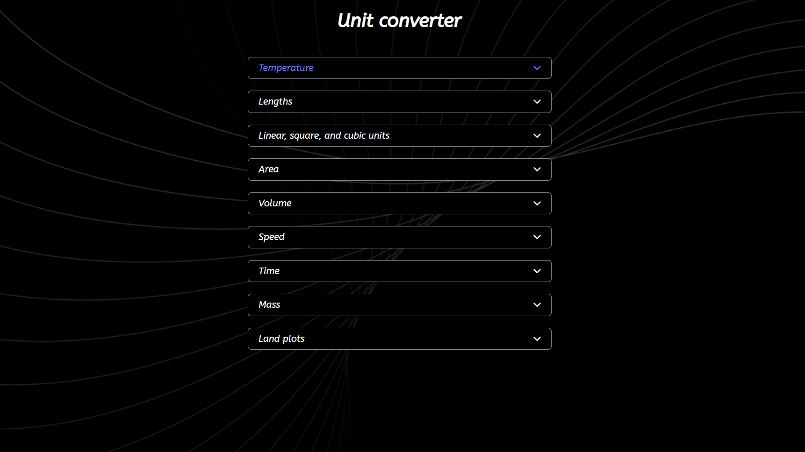
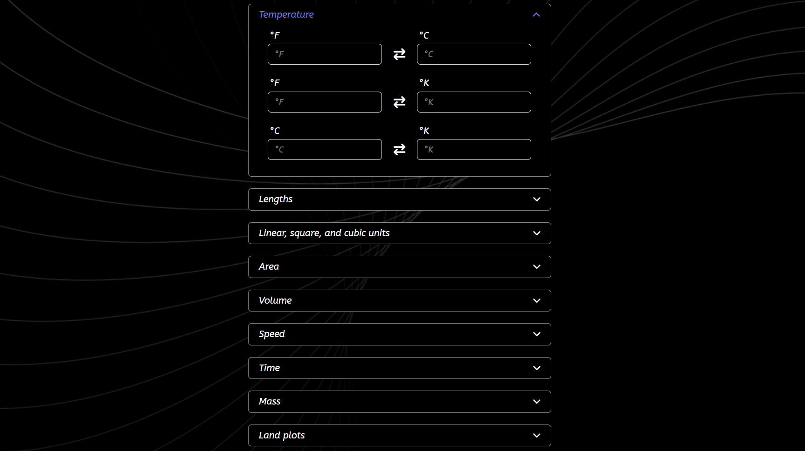
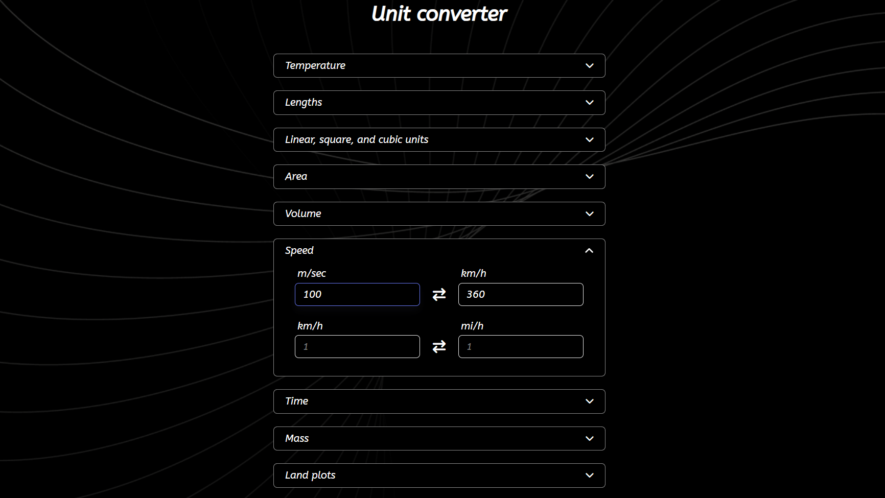

# 🔁  Unit converter

Unit Converter is a simple and convenient web application for converting units of measurement. Its clean UI and responsive design make it easy to use on any device.

🔗 [Live Demo](https://sofi-dobriak.github.io/unit-converter/)



---

## 📌 Features

### Supported categories:

 - Temperature (°C, °F, K)
 - Length (m, km, mi, ft, etc.)
 - Area (m², km², ac, ha, etc.)
 - Volume (L, m³, gal, etc.)
 - Speed (m/s, km/h, mph, etc.)
 - Time (s, min, h, days)
 - Mass (g, kg, lb, etc.)
 - Land area (hectare, acre, sq. m, etc.)



### User experience:

- Automatic result updating while typing (no extra clicks).
- Input validation to prevent incorrect values.
- Responsive design for smooth use on mobile and desktop.



---

## 🛠️ Tech Stack
  -  HTML
  -  SCSS
  -  JavaSCript
  -  Vite

## 🚀 Run Locally

1. Clone the repository:
   ```bash
   git clone https://github.com/sofi-dobriak/unit-converter.git
2. Navigate to the project folder:
    ```bash
    cd unit-converter
3. Install dependencies:
    ```bash
    npm install
4. Start the development server:
    ```bash
    npm run dev
5. Open in your browser:
    ```bash
    http://localhost:5173

---

👩‍💻 Author: Sofi Dobriak